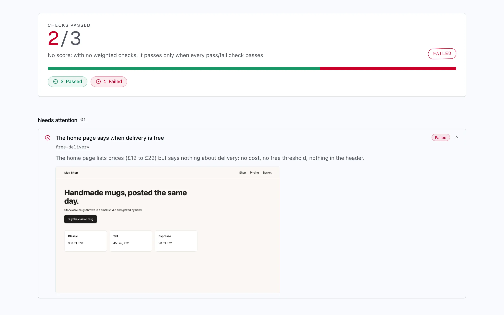
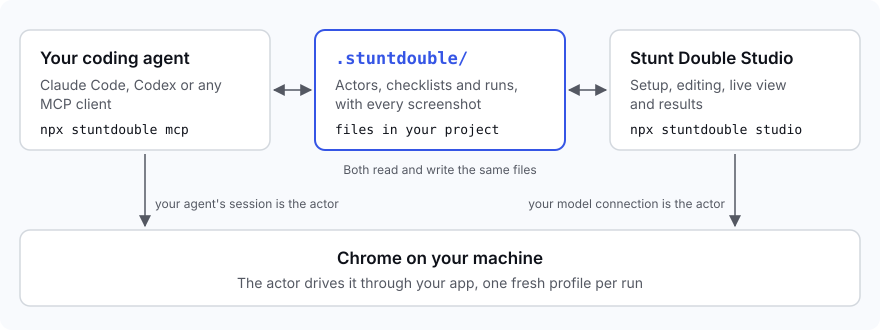
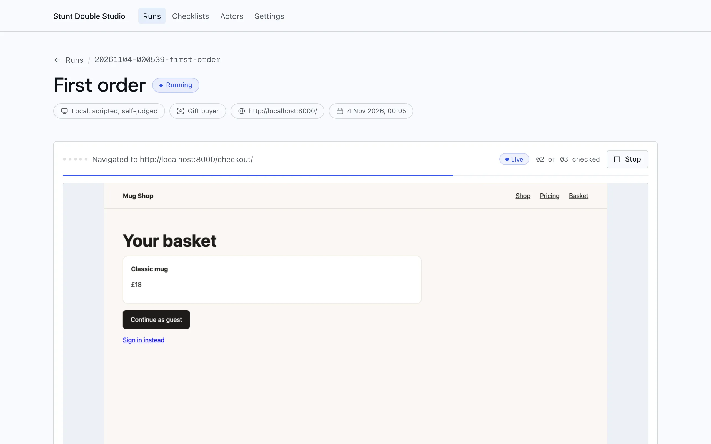
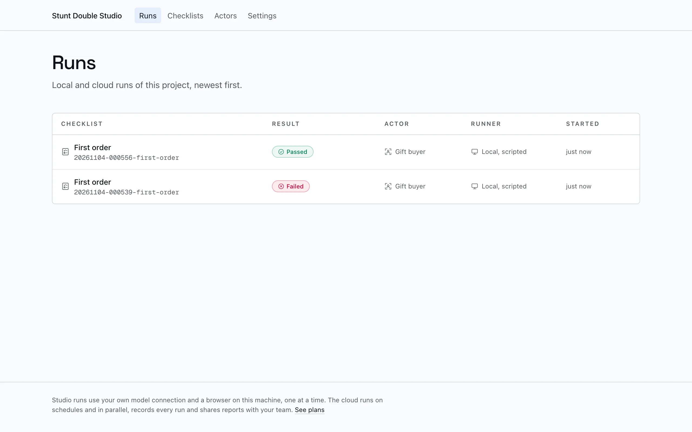
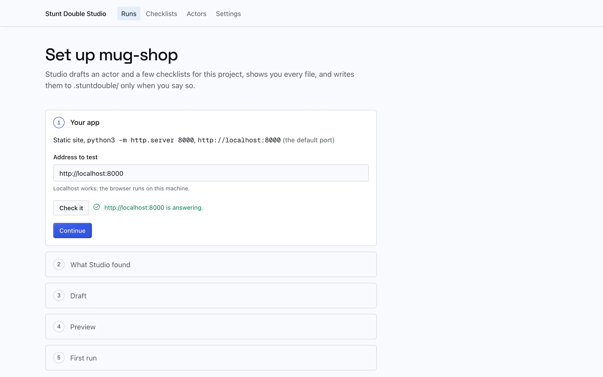
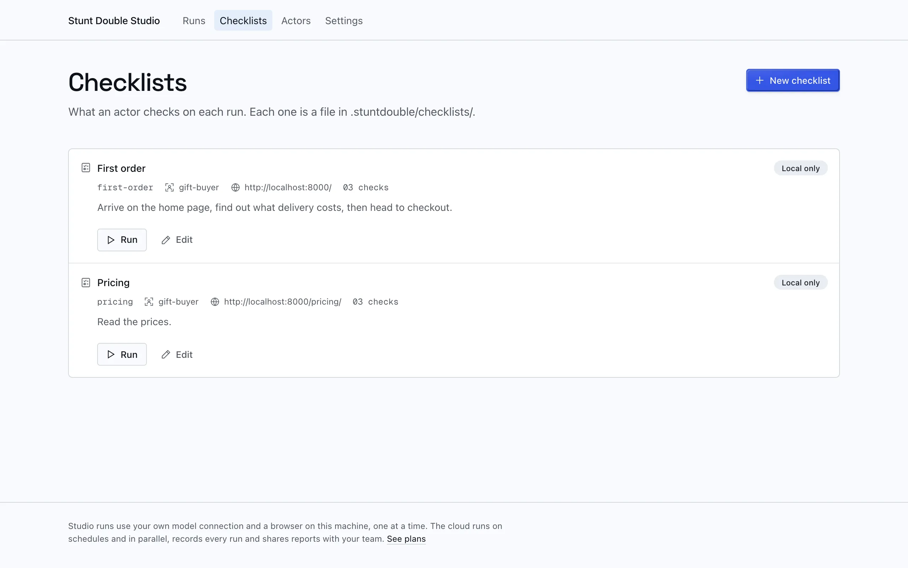

# Stunt Double Studio

[](https://www.npmjs.com/package/stuntdouble) [](https://github.com/stunt-double/studio/actions/workflows/ci.yml) [](./LICENSE)

See where your app fails a real person, before anyone else does.

An actor, an AI user, runs your checklist in a real Chrome on your machine. It brings back evidence for every check: the verdict, what it saw and a screenshot of the step. Studio is free and open source, and it runs on the coding agent or model connection you already have.

<picture>
  <source media="(prefers-color-scheme: dark)" srcset="docs/images/studio-run-failed-dark.webp">
  
</picture>

## Two ways to use it

**From your coding agent.** Install the Claude Code plugin, then ask for a run:

```sh
claude plugin marketplace add stunt-double/studio
claude plugin install stuntdouble@stuntdouble-studio
```

In Claude Code, `/stuntdouble:setup` writes the first actor and checklists, and `/stuntdouble:run <checklist>` runs one. Your agent's session is the actor: the MCP server never calls a model of its own. Codex and other MCP clients start `npx stuntdouble mcp`: [setup for each](docs/coding-agents.md).

**As a local app.** Open Studio in your browser:

```sh
npx stuntdouble studio
```

Studio covers setup, actors and checklists, runs, the live view and results. It runs on your own model connection: an Anthropic API key, or an OpenAI-compatible endpoint such as OpenAI, OpenRouter, or a local model in Ollama or LM Studio. It never uses a Claude subscription.

Both read and write the same `.stuntdouble/` files in your project, so a run your agent starts shows up in Studio, and every run is a file you can commit.



## The loop

Run a checklist, read what failed, fix it with your agent, run it again.

**1. Run it.** Watch the actor work through your app live, and stop it whenever you like.

<picture>
  <source media="(prefers-color-scheme: dark)" srcset="docs/images/studio-run-live-dark.webp">
  
</picture>

**2. Read what failed.** A pass has to cite text or an element that is on the page, so every verdict comes with its evidence. A failure says what the actor did and what it saw, with the screenshot.

**3. Fix it and run again.** Hand the failure to your coding agent, then press Run again. The runs list keeps every result.

<picture>
  <source media="(prefers-color-scheme: dark)" srcset="docs/images/studio-runs-dark.webp">
  
</picture>

## Inside Studio

A new project gets a guided setup on one page: Studio finds your dev server and your pages, drafts an actor and two to four checklists, and shows you every file before it writes anything. The guided setup is coming in the next release; 0.2.0 starts you with a first-time visitor actor and a first checklist to edit.

<picture>
  <source media="(prefers-color-scheme: dark)" srcset="docs/images/studio-setup-dark.webp">
  
</picture>

Checklists and actors are forms, checked by the same schemas a run reads the files with. Each one is a JSON file in `.stuntdouble/`.

<picture>
  <source media="(prefers-color-scheme: dark)" srcset="docs/images/studio-checklists-dark.webp">
  
</picture>

More on setup, the connection and run limits: [docs/studio.md](docs/studio.md).

## Cloud runs

Sign in to run the same checklist in your Stunt Double workspace: in parallel, on a schedule or on deploys, with a second, independent judge on the verdicts. Studio pushes the files, runs the checklist there and writes the result beside your local runs. Cloud runs are for paid plans: [see pricing](https://www.stuntdouble.io/pricing).

```sh
npx stuntdouble login
npx stuntdouble run <checklist> --cloud
```

The cloud cannot reach `localhost`, so give the checklist a public or preview URL and keep the local one in `local_base_url`. Details: [docs/studio.md#cloud-runs](docs/studio.md#cloud-runs).

## Reference

### Commands

```sh
npx stuntdouble studio [dir]           # open Studio for a project (the default in a terminal; --port, --no-open)
npx stuntdouble run <checklist>        # run one on your connection (--resume, --max-steps, --cloud)
npx stuntdouble login | logout         # sign in or out for cloud runs (--workspace <slug>)
npx stuntdouble mcp                    # the MCP server over stdio; your agent starts this
npx stuntdouble view [dir]             # the read-only viewer over a project's .stuntdouble/
npx stuntdouble doctor                 # Node, Chrome, the viewer port, the project, and how local runs are billed
```

The MCP tools are listed in [docs/coding-agents.md](docs/coding-agents.md#tools).

### Files

```
.stuntdouble/
  stuntdouble.json          the app's local address, headless, screenshots and safety settings
  actors/<slug>.json        who the actor is
  checklists/<slug>.json    where it starts, what it does and the checks
  runs/<stamp>-<checklist>/ run.json, activity.jsonl, shots/<check>.png, steps/<n>.jpg
  interviews/<slug>.json    a research interview guide, with a UMUX questionnaire at the end
  interview-runs/<stamp>-<interview>/ each session's transcript and ratings
  .live/                    the running viewer's state (not committed)
```

The same files run in the cloud. Every field, and how a run is scored: [docs/files-and-safety.md](docs/files-and-safety.md).

### Safety

- Every run gets a fresh Chrome profile, deleted afterwards. Your own profile is never used.
- The browser reaches local and private addresses only for the app under test.
- On any other host, the tools refuse to pay, subscribe, create an account or type a password or card number (set `safety` to `off` when your app signs in on another domain).
- The viewer and Studio listen on `127.0.0.1` only and need the key from the printed link.

The full rules: [docs/files-and-safety.md#safety](docs/files-and-safety.md#safety).

### The policy line

Inside your agent, your agent session is the only model: the MCP server never calls a model, never starts an agent and never reads an agent's credentials. Studio runs use only a connection you configure, an Anthropic API key or an OpenAI-compatible endpoint (OpenAI, OpenRouter, or a local server such as Ollama or LM Studio). Your key stays in `~/.stuntdouble/credentials.json`, readable by you only, and never reaches the page or the project. Nothing in this package uses a Claude subscription: no claude.ai login, no Claude Code credentials, no `claude` process. `test/no-model.test.ts` fails the build if any of that changes.

### Requirements

Node 22.18 or later, and Google Chrome (or Playwright's Chromium, from `npx playwright install chromium`).

## Contributing

Issues and pull requests are welcome: see [CONTRIBUTING.md](./CONTRIBUTING.md), and report security problems privately as [SECURITY.md](./SECURITY.md) describes.

## Licence

[Apache-2.0](./LICENSE), copyright 2026 Turnout Labs Ltd.
